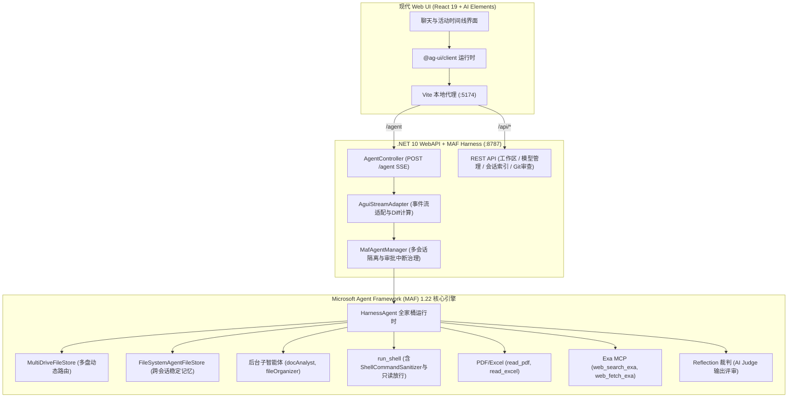

# MAF Harness 智能体全功能工作台

基于 **[Microsoft Agent Framework (MAF)](https://learn.microsoft.com/agent-framework/)** 1.22 核心框架与 **.NET 10 WebAPI** 封装，通过 **AG-UI 协议** 全栈对接现代 React 19 + AI SDK Elements 前端 UI 的智能体工作台应用。

后端框架内置的全部功能（多盘文件读写、任务清单分解、规划/执行模式切换、跨会话文件记忆与自动沉淀、反思裁判自检、文档分析子智能体、目录整理子智能体、智能终端 Shell、人工安全审批 HITL、行级 Diff 对比、思考流折叠展开）已全功能对接到 Web 前端，并在主面板中以建议提示词（Prompt Starters）卡片形式直观呈现。

---

## 1. 架构总览



---

## 2. 后端全部内置能力与前端对接清单

| 功能模块 | MAF Harness 内置机制 | 前端 AG-UI 对接方式 | 实测状态 |
| :--- | :--- | :--- | :---: |
| **工作区人格** | `workspace/AGENTS.md` + 注入前缀 | 遵循预设行为规范，用中文友好回答 | ✅ 已对接 |
| **流式正文输出** | `TextContent` 流式增量 | `TEXT_MESSAGE_START` / `CONTENT` / `END` 打字机渲染 | ✅ 已对接 |
| **思考流折叠/展开** | `TextReasoningContent` | `REASONING_MESSAGE_START` / `CONTENT` / `END`，折叠气泡展示思维链 | ✅ 已对接 |
| **任务清单 Todo** | `TodoCompletionLoopEvaluator` + `todos_*` | `CUSTOM` (`deepagent:activity` kind=todo)，实时待办清单卡片与进度 | ✅ 已对接 |
| **文件变更 Diff** | `MultiDriveFileStore.FileChanged` + LCS 计算 | 自动计算行级增删差异，高亮渲染 `Δ +N -N` 差异预览卡片 | ✅ 已对接 |
| **工具调用卡片** | `FunctionCallContent` / `FunctionResultContent` | `CUSTOM` (`deepagent:activity` kind=tool/file)，实时渲染参数与结果截断 | ✅ 已对接 |
| **文档分析子智能体** | `docAnalyst` (PDF/Excel 分析只读代理) | `CUSTOM` (`deepagent:activity` kind=subagent)，独立卡片展示任务与结构化中文摘要 | ✅ 已对接 |
| **文件整理子智能体** | `fileOrganizer` (目录扫描与规划只读代理) | `CUSTOM` (`deepagent:activity` kind=subagent)，独立卡片展示扫描与规划方案 | ✅ 已对接 |
| **智能终端 Shell** | `LocalShellExecutor` + `ShellCommandClassifier` | 自动识别只读命令免审放行，结构/权限修改触发审批，终端面板交互 | ✅ 已对接 |
| **模式切换** | `mode_get` / `mode_set` (plan / execute) | 复杂任务先进入 plan 模式规划，经确认切入 execute 模式动手 | ✅ 已对接 |
| **反思裁判自检** | `ReflectOnIterationAsync` (AI Judge 评审) | `CUSTOM` (`deepagent:process-message`)，时间线中实时展示反思结果 | ✅ 已对接 |
| **跨会话文件记忆** | `file_memory_*` + 后台异步事实抽取沉淀 | 回合结束后后台模型抽取事实存入 `agent-file-memory/current` 稳定目录 | ✅ 已对接 |
| **人工安全审批 (HITL)** | `ToolApprovalAgent` + 审批拦截 | AG-UI `interrupt` 机制，前端弹出审批确认卡片，提交后 `resume` 唤醒后续执行 | ✅ 已对接 |
| **多会话持久化** | `AgentSession` 序列化与恢复 | 各会话按 `threadId` 隔离记忆与活动日志，切换对话互不打扰 | ✅ 已对接 |
| **工作区文件树** | 文件系统 API | 实时获取工作区目录树、新建文件夹、切换根目录 | ✅ 已对接 |
| **多模型提供商** | `ProviderService` | 预置主流 OpenAI 兼容聚合端点，支持前端动态添加、测速与模型探测 | ✅ 已对接 |
| **代码审查 Review** | `GitService` + 终端执行 | 右侧侧边栏展示 Git 状态、逐文件 Diff、提交与 PowerShell 交互式终端 | ✅ 已对接 |

---

## 3. 主面板建议提示词 (Prompt Starters)

在主面板中，预置了覆盖 MAF 全部内置能力的建议提示词卡片，一键点击即可体验：

1. **待办清单**（`todos_*`）：任务清单与自治循环 —— 任务分解、待办清单跟踪与自动流转
2. **文件变更**（`file_access_*`）：多盘读写与行级 Diff —— 多盘文件读写/替换与行级差异对比
3. **深度思考**（`TextReasoningContent`）：深度推演与思维链 —— 流式输出思考过程并支持实时折叠展开
4. **文档子Agent**（`docAnalyst`）：委派 docAnalyst 分析文档 —— 委派只读子智能体解析 PDF / Excel 并提取结构化中文摘要
5. **整理子Agent**（`fileOrganizer`）：委派 fileOrganizer 归类 —— 委派子智能体扫描目录并规划归类方案
6. **智能终端**（`run_shell`）：Shell 命令与安全放行 —— PowerShell 命令执行，只读自动免审与结构审批
7. **模式切换**（`mode_set / mode_get`）：规划与执行模式切换 —— 从 plan 规划模式到 execute 执行模式严谨推进
8. **长期记忆**（`file_memory_*`）：跨会话记忆检索与沉淀 —— 事实抽取落盘与跨会话记忆检索

---

## 4. 环境要求

- **.NET SDK 10.0+**（.NET 10.0.400+）
- **Node.js 20+ / 24+**
- **pnpm 9+ / 10+**
- **PowerShell 7+ / Windows PowerShell**

---

## 5. 快速开始

### 5.1 一键启动（Windows）

双击根目录下的 `run.cmd` 或运行 `run.ps1`：
- 自动检测环境并启动 .NET 10 WebAPI 后端服务（`http://127.0.0.1:8787`）；
- 启动前端 Vite 开发服务器（`http://127.0.0.1:5174`）；
- 浏览器访问 `http://127.0.0.1:5174` 即可使用。

```cmd
run.cmd
```

### 5.2 手动分步启动

#### 终端 1：启动 .NET 10 WebAPI 后端

```bash
cd backend
dotnet run
```
后端服务端口为 `8787`，健康检查地址为 `http://127.0.0.1:8787/api/health`。

#### 终端 2：启动 Web 前端

```bash
cd frontend
pnpm install
pnpm --filter @deepagent/web dev --host 127.0.0.1 --port 5174
```
浏览器访问：`http://127.0.0.1:5174`。

---

## 6. 服务端 API 接口清单

| 请求方式 | 路径 | 功能说明 |
| :--- | :--- | :--- |
| `GET` | `/api/health` | 健康检查与 MAF 运行状态 |
| `POST` | `/agent` | AG-UI 协议 SSE 流式执行端点 |
| `POST` | `/agent/cancel` | 中断取消指定会话的任务 |
| `GET` | `/api/workspace/tree` | 获取当前工作区文件目录树 |
| `POST` | `/api/workspace/select` | 切换当前工作区根目录 |
| `POST` | `/api/workspace/mkdir` | 在工作区内创建新目录 |
| `GET` | `/api/workspace/browse` | 浏览指定目录文件 |
| `GET` | `/api/providers` | 获取所有已配置大模型提供商（API Key 自动掩码） |
| `POST` | `/api/providers` | 添加新的大模型提供商 |
| `PUT` | `/api/providers/{id}` | 更新提供商配置 |
| `DELETE` | `/api/providers/{id}` | 删除提供商配置 |
| `POST` | `/api/providers/{id}/models` | 远程探测提供商模型列表 |
| `POST` | `/api/providers/{id}/test` | 连通性与延迟测试 |
| `GET` | `/api/workbench` | 获取工作台索引与会话列表 |
| `PUT` | `/api/workbench` | 更新工作台索引 |
| `GET/PUT/DELETE` | `/api/workbench/sessions/{threadId}` | 会话状态持久化与清理 |
| `GET` | `/api/git/status` | 获取 Git 状态与变更文件列表 |
| `GET` | `/api/git/diff` | 获取指定文件的统一 Diff 对比 |
| `POST` | `/api/git/commit` | 提交代码变更 |
| `GET` | `/api/git/file-content` | 读取文件文本内容 |
| `POST` | `/api/git/terminal` | 执行交互式终端 PowerShell 命令 |
