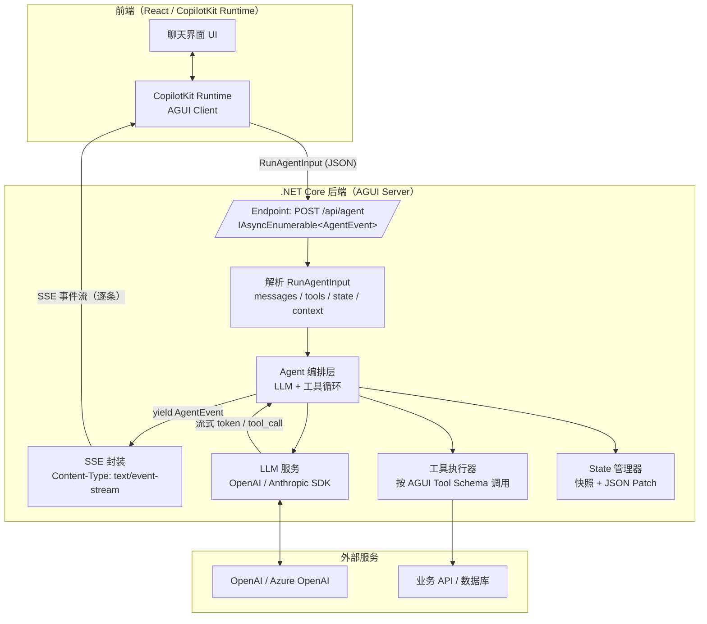
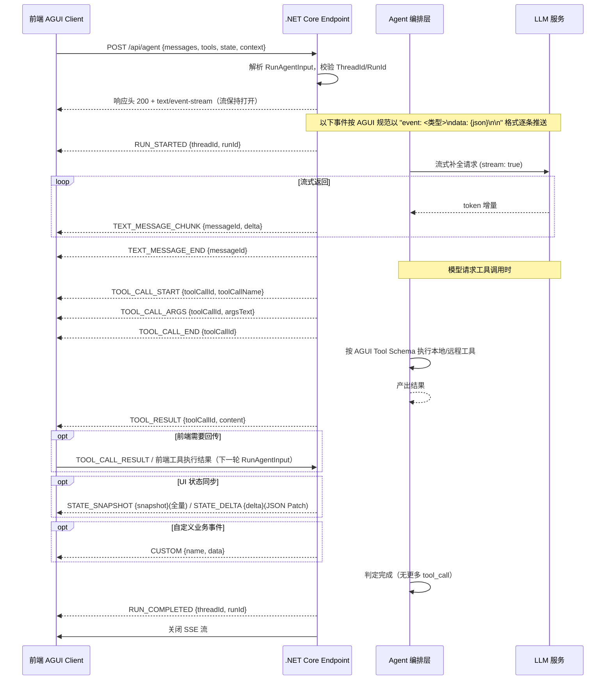
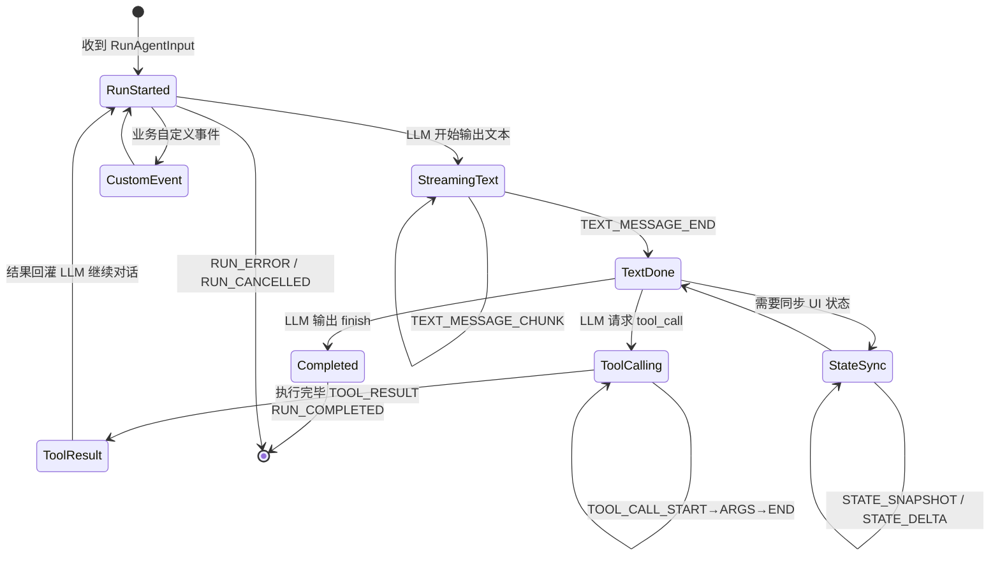

# AGUI 协议 .NET Core 对接流程图

> AGUI（Agent-UI）协议是 CopilotKit 主导的开源协作协议：基于 **HTTP + Server-Sent Events (SSE)**，让 Agent 把流式消息、工具调用、UI 状态实时推送给前端。
> 以下流程图描述 .NET Core 后端作为 **AGUI Server** 的完整对接链路。

---

## 一、整体架构图（flowchart）

---

## 二、核心交互时序图（sequence diagram）

---

## 三、事件流转状态机（state diagram）

---

## 四、.NET Core 实现要点速查

| 环节 | 实现方式 |
|---|---|
| 协议入口 | Minimal API `app.MapPost("/api/agent", async (RunAgentInput input, CancellationToken ct) => ...)` |
| 返回流 | 返回 `IAsyncEnumerable<AgentEvent>`，配合 `Results.Stream(...)` 自动输出 SSE |
| 事件模型 | 强类型 record `AgentEvent`，序列化为 `event: <type>\ndata: {json}\n\n`（遵 AGUI 规范，CopilotKit 提供 `CopilotKitProtocol` NuGet 包可直接引用） |
| 输入契约 | `RunAgentInput { Messages, Tools, State, ThreadId, RunId, Context }` |
| 工具契约 | `Tool { Id?, Name, Description, Parameters(JsonSchema) }`，工具调用回 `ToolCall` / `ToolResult` |
| 状态同步 | 维护可序列化 State 对象：初次/大变更发 `STATE_SNAPSHOT`，增量发 `STATE_DELTA`（RFC6902 JSON Patch，可用 `Microsoft.AspNetCore.JsonPatch`） |
| 取消 | 监听 `CancellationToken`（客户端断开 SSE 自动触发），发 `RUN_CANCELLED` 后终止 |
| 校验 | 每条事件保证 `type` 字段存在；`messageId` / `toolCallId` 全程唯一 |

---

## 五、对接步骤清单（Checklist）

1. 引入 `CopilotKit.Protocol`（AGUI 协议包）或自行按规范定义事件模型
2. 新建 Minimal API 端点，返回 `IAsyncEnumerable<AgentEvent>` + `Results.Stream`
3. 注入 LLM 客户端（`OpenAI` / `Azure.AI.OpenAI` SDK），开启 `stream: true`
4. 把 LLM 流 token 映射为 `TEXT_MESSAGE_*` 事件流
5. 按协议声明 Tools（JSON Schema 参数），处理 `TOOL_CALL_*` 与 `TOOL_RESULT`
6. 实现 State 快照/增量推送（`STATE_SNAPSHOT` / `STATE_DELTA`）
7. 处理取消令牌与错误事件（`RUN_CANCELLED` / `RUN_ERROR`）
8. 前端用 CopilotKit Runtime 或自研 SSE 客户端联调，确认 events 逐行解析
